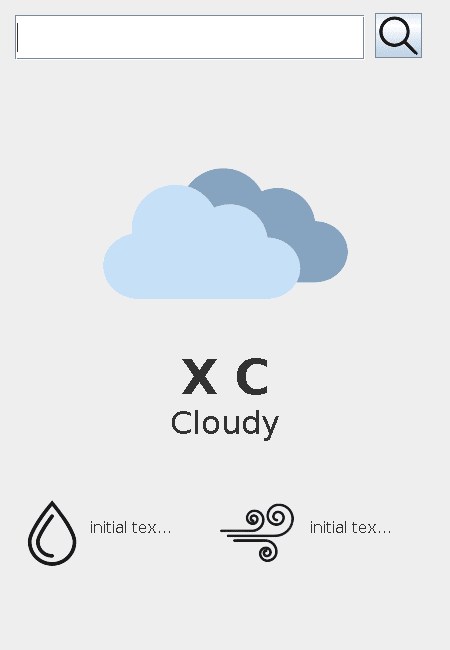
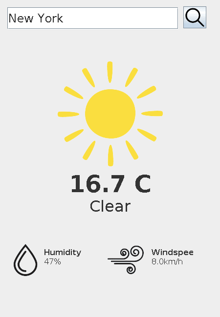
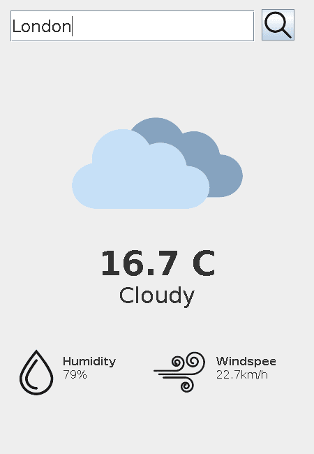

# WeatherAPI

A small Java Swing desktop app that shows the current weather for any city. Type a city name, press the search button, and it shows the temperature, a matching weather icon, the condition, the humidity and the wind speed.

The data comes from the free [Open-Meteo](https://open-meteo.com/) APIs (no API key needed). The window itself is described in XML: the layout (`src/weather_layout.xml`) and the image resources (`src/resources.xml`) are loaded at startup, so you can move or restyle components without touching the Java code.

## Screenshots

| Startup | New York (clear) | London (cloudy) |
|---|---|---|
|  |  |  |
| Before the first search the labels show placeholder values. | A search for "New York": the sun icon is shown for a clear sky. | A search for "London": the cloud icon is shown for a cloudy sky. |

## Features

- Search any city by name. The first match from the Open-Meteo geocoding API is used.
- Shows the temperature (°C), the condition (Clear, Cloudy, Rain or Snow) with a matching icon, the relative humidity (%) and the wind speed (km/h) for the current hour.
- The GUI is built from an XML layout file, and images are looked up by id from an XML resource file.
- JSON responses are mapped to plain Java classes with Gson.

## Requirements

- JDK 11 or newer (it uses `java.net.http.HttpClient`)
- [Gson](https://github.com/google/gson) 2.x. The project expects `lib/gson-2.14.0.jar`
- An internet connection

## Build and run

Run these from the project root. The app loads `src/resources.xml`, `src/weather_layout.xml` and `assets/*.png` relative to the working directory, so it has to start from there.

```bash
# compile
javac -cp lib/gson-2.14.0.jar -d out/production/WeatherAPI src/*.java

# run (on Windows use ; instead of : in the classpath)
java -cp out/production/WeatherAPI:lib/gson-2.14.0.jar AppLauncher
```

In IntelliJ IDEA, open the folder, add `lib/gson-2.14.0.jar` as a library (the module already refers to a `gson-2.14.0` library), set the working directory to the project root and run `AppLauncher`.

## How it works

1. `Weather` (the `JFrame`) loads the resources and the layout, then wires the search button.
2. On search, `DataFetcher` asks `WeatherApiClient` for the location (`geocoding-api.open-meteo.com/v1/search`) and then the hourly forecast for its coordinates (`api.open-meteo.com/v1/forecast`).
3. `DataFetcher` picks the entry for the current hour and turns the WMO weather code into Clear, Cloudy, Rain or Snow.
4. `Weather` updates the labels and swaps the icon to the resource `weather_<condition>`.

## Project structure

```
src/
  AppLauncher.java        main(): opens the Weather window on the Swing thread
  Weather.java            the window: loads layout and resources, handles search
  GuiLayout.java          builds JTextField, JLabel and JButton components from weather_layout.xml
  ResourceLoader.java     loads images listed in resources.xml and resolves them by id
  DataFetcher.java        geocode, fetch forecast, pick the current hour, map weather codes
  WeatherApiClient.java   HTTP calls to the Open-Meteo geocoding and forecast APIs (Gson parsing)
  WeatherData.java        the values shown in the UI
  GeocodingResponse.java, GeocodingResult.java, ForecastResponse.java, HourlyData.java
                          Gson models for the API responses
  weather_layout.xml      component positions, sizes, fonts and texts
  resources.xml           image ids mapped to files in assets/
assets/                   weather, humidity, wind and search icons
lib/                      gson-2.14.0.jar
```

## Known limitations

- Weather codes outside the four groups (for example fog, code 45/48) show no condition text and keep the previous icon.
- The forecast is requested in UTC, but the current hour is matched against the local clock, so outside UTC the values can be for a different hour.
- The "Windspeed" label is a little too narrow and is cut off as "Windspee".
- A city that is not found, or a network error, is only reported on the console.
